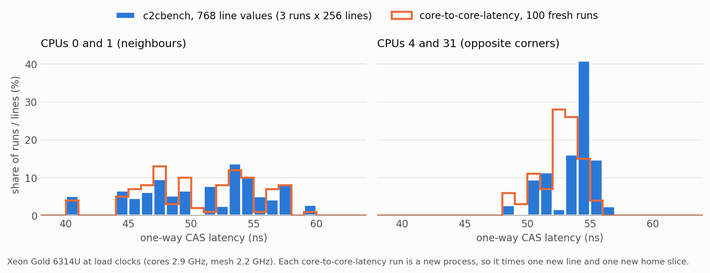
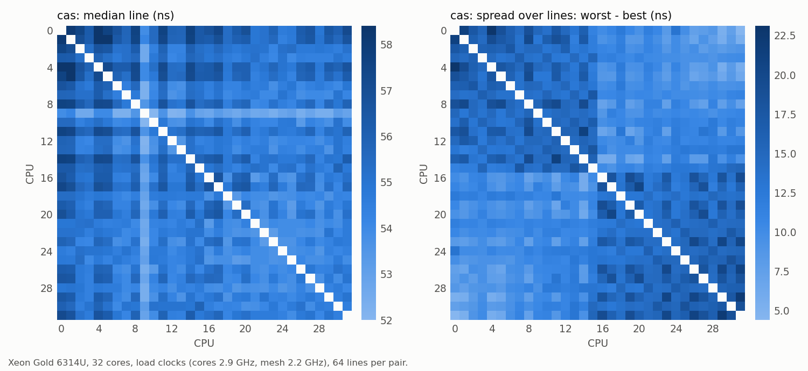
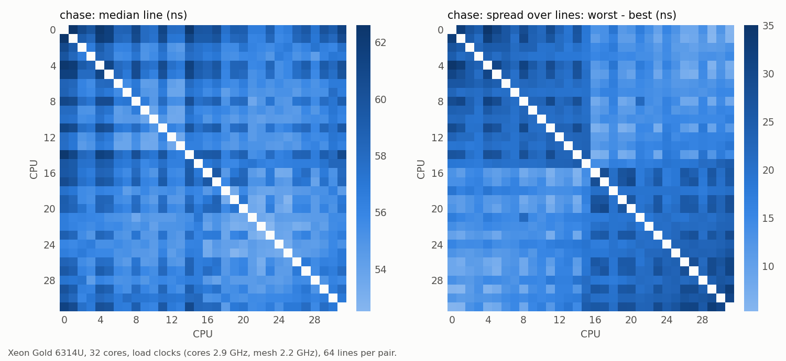

# c2cbench

Core-to-core latency, **per cache line**.

Tools like [c2clat](https://github.com/rigtorp/c2clat) and
[core-to-core-latency](https://github.com/nviennot/core-to-core-latency) time one
shared cache line per core pair. On mesh and ring CPUs a shared line moves
owner → **home slice** → requester, and the home comes from an undocumented
hash of the line's address. So "the latency between two cores" depends on which
line you happened to get. c2cbench times many lines per pair (64 by default) and
reports the best, median and worst.



Run a one-line tool again and it gets a new line, so a new home: for neighbouring
cores 0 and 1, 100 fresh core-to-core-latency runs land anywhere from 40 to 59 ns,
in clusters. That run-to-run spread is the line-to-line spread c2cbench measures
in a single run. For cores at opposite corners of the mesh the spread is small:
most homes sit near the path between them, so every line takes about as long.

```
$ ./c2cbench -c 0,1,4,5,17,20 -s 1
c2cbench cas: median line, one-way ns (64 lines per pair)
         0    1    4    5   17   20
    0        53   53   53   51   50
    1   53        53   52   50   50
    4   53   53        53   50   50
    5   53   52   53        50   50
   17   51   50   50   50        49
   20   50   50   50   50   49     

seed 1 (reproduce with -s 1)
per pair, over 64 lines: worst - best = 12.9 ns (median over pairs), up to 19.3 ns;
best line vs median line: 10% faster (median over pairs), up to 24%

$ ./c2cbench -m chase -c 0,1,4,5,17,20 -s 1
c2cbench chase: median line, one-way ns (64 lines per pair)
         0    1    4    5   17   20
    0        63   63   62   58   57
    1   63        62   61   57   56
    4   63   62        61   57   56
    5   62   61   61        57   56
   17   58   57   57   57        56
   20   57   56   56   56   56     

seed 1 (reproduce with -s 1)
per pair, over 64 lines: worst - best = 14.7 ns (median over pairs), up to 34.8 ns;
best line vs median line: 8% faster (median over pairs), up to 32%
```

All 32 cores, median line and per-pair spread (worst line − best line):




Numbers here are from a Xeon Gold 6314U at load clocks: turbo on, `performance`
governor, mesh at its maximum (cores ran at 2.9 GHz all-core, mesh at 2.2 GHz).

## Build and run

```sh
make            # or: g++ -O2 -std=c++17 -pthread c2cbench.cpp -o c2cbench
./c2cbench                       # every pair of physical cores
./c2cbench -c 0-7 --csv          # one row per pair: best,p10,median,p90,worst,seed
./c2cbench -p | gnuplot -p       # heatmaps of the median and the best line
./c2cbench -m chase              # pointer chase: one-way read of a line the other core wrote
./c2cbench -m chase --offset 96K # the same, with the writer's copy in its L2
```

Linux on x86-64 or AArch64, C++17, one file, no dependencies. Lines live in
explicit 2 MiB hugepages, so reserve 16 first: `sudo sysctl vm.nr_hugepages=16`.
Fixed physical pages keep every line's home for the whole run and keep TLB
misses out of the numbers.

## Modes

- **cas**: both cores CAS one line in turn, like a lock handoff. Each core
  retries its `lock cmpxchg` until the other's has landed, exactly as c2clat's
  `-w` and core-to-core-latency's CAS test do, so only the number of lines
  differs. Reported as half a round trip.
- **chase**: the lower-numbered CPU writes a pointer chain through some of the
  lines, so each sits modified in its cache; the other CPU follows the chain.
  Each hop is one dependent read of a line the other core just wrote: the
  one-way transfer itself, with no round trip and no lock retries. Chains of
  different lengths over different lines are timed whole, and a least-squares
  fit splits them into a fixed overhead plus a cost per line, so even coarse
  timers give per-line results.
  By default the writer's copy is still in its L1 when the reader asks for it
  (L1 → L1), as in a producer handing data straight to a consumer. With
  `--offset SIZE` the writer stores SIZE bytes of its own after each chain,
  pushing the chain into its L2 (L2 → L1): on the Xeon 6314U (L1d 48 KB, L2
  1.25 MB) any offset from 64K to 768K reads ~2.5-3 ns faster than L1 → L1.
  Keep it below the L2 size: past it the chain falls to the shared cache and
  the reads become ~24 ns cache hits, not core-to-core transfers (c2cbench warns).

Values are one-way ns per line. Candidate lines sit one per 128-byte block in
hugepage memory, so the adjacent-line prefetcher never pairs two of them, and
chains visit them in random order. Every selected CPU runs one pinned worker
that spins for the whole run, so idle cores are never timed before they ramp up
(this uses those CPUs at 100% while c2cbench runs).

## Reading the results

- **A large worst − best spread for one pair is the home effect.** It is
  placement, not noise; the same lines keep their homes for the life of the process.
- **Each run picks new lines** (a random seed, printed with the results and in
  the CSV's last column); `-s SEED` measures the same line set again.
- **Measure at load clocks.** With power management left alone, a light
  two-core ping-pong can let the mesh drop to its lowest clock and roughly
  double every number. Set the `performance` governor and, where the driver
  allows it, hold the uncore at its maximum
  (`/sys/devices/system/cpu/intel_uncore_frequency/*/min_freq_khz`).
- **Store/load ping-pongs are not one transfer.** c2clat's default test and
  core-to-core-latency's `-b 2` move each line twice per one-way step (the
  writer must take its line back from the reader), so they read about twice
  the chase.

License: Apache-2.0.
