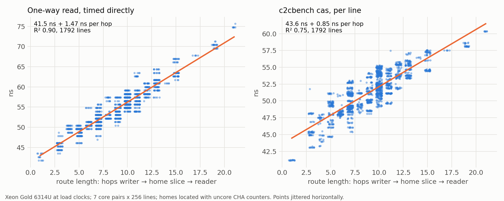

# c2cbench

Core-to-core latency, **per cache line**.

Tools like [c2clat](https://github.com/rigtorp/c2clat) and
[core-to-core-latency](https://github.com/nviennot/core-to-core-latency) time one
shared cache line per core pair. On mesh and ring CPUs a shared line moves
owner → **home slice** → requester, and the home comes from an undocumented
hash of the line's address. So "the latency between two cores" depends on which
line you happened to get. c2cbench's `cas` mode times 256 lines per pair and
reports the mean over them, the spread, and on request a histogram, whose modes
are the homes. Its `chase` mode reports the mean one-way read over 8192 lines per
pair that no core has loaded before.



Each line's latency follows its route: writer → home slice → reader. Locating
every line's home with uncore counters (a separate research tool, not part of
c2cbench) shows one-way reads cost 41.5 ns + 1.47 ns per mesh hop of that route
on this Xeon, and c2cbench's per-line CAS times follow the same route
(43.6 ns + 0.85 ns per hop).


Run a one-line tool again and it gets a new line, so a new home: for neighbouring
cores 0 and 1, 100 fresh core-to-core-latency runs land anywhere from 40 to 59 ns,
in clusters. That run-to-run spread is the line-to-line spread c2cbench measures
in a single run. For cores far apart the spread is small: most homes sit near the
path between them, so every route is about as long.

```
$ ./c2cbench -c 0,1,4,5,17,20 -s 1
c2cbench cas: mean over lines, one-way ns (256 lines per pair)
         0    1    4    5   17   20
    0        51   51   50   51   50
    1   51        50   50   50   50
    4   51   50        50   51   50
    5   50   50   50        50   50
   17   51   50   51   50        50
   20   50   50   50   50   50     

seed 1 (reproduce with -s 1)
per pair, over 256 lines: worst - best = 9.4 ns (median over pairs), up to 19.4 ns;
best line vs mean: 10% faster (median over pairs), up to 20%

$ ./c2cbench -m chase -c 0,1,4,5,17,20 -s 1
c2cbench chase: mean over fresh lines, one-way ns (8192 lines per pair, each used once)
         0    1    4    5   17   20
    0        58   59   57   58   58
    1   58        58   57   58   58
    4   59   58        58   59   59
    5   57   57   58        58   58
   17   58   58   59   58        58
   20   58   58   59   58   58     

seed 1 (reproduce with -s 1); writer offset 0 B
chains of 256 lines from a pool of 100000: p90 - p10 over chains = 0.9 ns (median over pairs); 6 disturbed chains dropped
```

For one pair, `--hist` shows the per-line times, one cluster per group of homes
at a similar distance (CPUs 0 and 1 are neighbours, so routes run from 1 to 21
hops):

```
$ ./c2cbench -c 0,1 --hist -s 1
CPUs 0-1: 256 lines, mean 51.1 ns
   40.0    14 #####################
   41.0     0 
   42.0     0 
   43.0     0 
   44.0     8 ############
   45.0    12 ##################
   46.0    12 ##################
   47.0    26 #######################################
   48.0    10 ###############
   49.0    27 ########################################
   50.0     0 
   51.0    20 ##############################
   52.0    18 ###########################
   53.0    34 ##################################################
   54.0    15 #######################
   55.0    14 #####################
   56.0    17 #########################
   57.0    21 ###############################
   58.0     3 #####
   59.0     5 ########
```

All 32 cores: CAS, the mean over lines and the per-pair spread (p90 − p10 of the
lines); chase, the mean over fresh lines:


The means vary by a few ns with where the two cores sit (cores near the mesh's
edge are farther from the average home); the topology shows most in the spread. On this
part CPUs 0-15 sit in the left half of the mesh and 16-31 in the right half. Two
cores in the same half see routes of very different lengths depending on where a
line's home is (about 3.7 hops of spread over the 32 homes); two cores in opposite
halves have most homes near the path between them (about 2.4 hops), so their
lines all cost about the same.

Numbers here are from a Xeon Gold 6314U at load clocks: turbo on, `performance`
governor, mesh at its maximum (mesh at 2.2 GHz; cores at 2.9 GHz all-core for the
32-core heatmaps, higher turbo for the 6-CPU examples, which is why their CAS
means are a few ns lower).

## Build and run

```sh
make            # or: g++ -O2 -std=c++17 -pthread c2cbench.cpp -o c2cbench
./c2cbench                       # every pair of physical cores
./c2cbench -c 0-7 --csv          # one row per pair: best,p10,median,p90,worst,mean,seed
./c2cbench -c 0,1 --hist         # per-line histogram for one pair (--csv: one row per line)
./c2cbench -m chase              # pointer chase: one-way read of a line the other core wrote
./c2cbench -m chase --offset 96K # the same, with the writer's copy in its L2
```

Linux on x86-64 or AArch64, C++17, no dependencies. Lines live in
explicit 2 MiB hugepages, so reserve 16 first: `sudo sysctl vm.nr_hugepages=16`.
Fixed physical pages keep every line's home for the whole run and keep TLB
misses out of the numbers.

The source is split by job: `harness.hpp` (CPU list, pinned workers, lines,
statistics), `cas.hpp` and `chase.hpp` (one benchmark each), and `c2cbench.cpp`
(command line and output). The headers stand alone, so other tools can reuse
the harness or a benchmark. `docs/heatmaps.py` draws heatmaps from `--csv`.

## Modes

- **cas**: both cores CAS one line in turn, like a lock handoff. Each core
  retries its `lock cmpxchg` until the other's has landed, exactly as c2clat's
  `-w` and core-to-core-latency's CAS test do, so only the number of lines
  differs. Reported as half a round trip, per line: the same address is used for
  all of a line's round trips, so each line's time is stable and the per-line
  spread is its home.
- **chase**: the lower-numbered CPU writes a pointer chain of 256 lines, so
  each sits modified in its cache; the other CPU follows the chain. Each hop is
  one dependent read of a line the other core just wrote: the one-way transfer
  itself, with no round trip and no lock retries. Every chain is made of lines no
  core has loaded before (drawn from a pool of 100,000, reshuffled when it runs
  out), because some cores learn chains: on Graviton5 (Neoverse V3) walking a
  chain a second time is 35-38% cheaper per hop, and even a new order over the
  same lines 17-19%, so a chase that revisits lines reads low there. The result
  is a mean per pair (8192 lines in 32 chains, timed whole; chains hit by a
  disturbance, far above the pair's median, are dropped), not per-line values.
  By default the writer's copy is still in its L1 when the reader asks for it
  (L1 → L1), as in a producer handing data straight to a consumer. With
  `--offset SIZE` the writer stores SIZE bytes of its own after each chain,
  pushing the chain into its L2 (L2 → L1): on the Xeon 6314U (L1d 48 KB, L2
  1.25 MB) any offset from 64K to 768K reads ~2.5-3 ns faster than L1 → L1.
  Keep it below the L2 size: past it the chain falls to the shared cache and
  the reads become ~24 ns cache hits, not core-to-core transfers (c2cbench warns).

Values are one-way ns. Lines sit one per 128-byte block (at a random half of
it) in 32 MiB of hugepage memory: the adjacent-line prefetcher never pairs two
of them, and 16 pages fit the first-level TLB, so walks pay no TLB misses.
Every selected CPU runs one pinned worker
that spins for the whole run, so idle cores are never timed before they ramp up
(this uses those CPUs at 100% while c2cbench runs).

## Timing

c2cbench reads `std::chrono::steady_clock` once before and once after each
timed block (a line's 200 CAS round trips, or a whole 255-hop chain), never per
operation. On Linux that is `clock_gettime(CLOCK_MONOTONIC)` in the vDSO, with
no system call. On x86 the vDSO reads the TSC with `rdtscp` (checked by
disassembling the vDSO on the Xeon 6314U, kernel 7.0, clocksource `tsc`);
`rdtscp` waits for all earlier instructions, so the end time is taken after the
walk's last load. On AArch64 it reads `CNTVCT_EL0` after an `isb`.

- Overhead: one clock read costs about 20-35 ns. A chain takes about 15 us and
  a line's CAS block about 20 us, so the reads add 0.1-0.2%. c2cbench does not
  subtract them.
- Start of a block: instructions after `rdtscp` may begin before it reads the
  counter (no trailing `lfence`), so the first hop can start a few tens of
  cycles early: under 0.05 ns per hop over 255 hops.
- The fully fenced pattern is `lfence; rdtsc` to start and `rdtscp; lfence` to
  end (see Matt Godbolt, [It's About Time](https://hudson-trading.github.io/its-about-time/),
  C++Now 2026). At these block lengths it would not change the results, and
  `steady_clock` keeps the code portable and in ns without TSC calibration.
- A walk is checked to end on its chain's last line, so the compiler cannot drop
  or shorten it.

## Reading the results

- **A large spread for one pair is the home effect.** It is placement, not
  noise: each line's route through its home slice sets its latency, and the
  same lines keep their homes for the life of the process. `--hist` shows it as
  separate clusters.
- **The mean is the headline, not the median.** For neighbouring cores the
  per-line values come in near-home and far-home clusters, and a median jumps
  between them from run to run; the mean is the expected latency of a randomly
  placed line, and moves far less.
- **Each run picks new lines** (a random seed, printed with the results and in
  the CSV's last column); `-s SEED` measures the same line set again.
- **Measure at load clocks.** With power management left alone, a light
  two-core ping-pong can let the mesh drop to its lowest clock and roughly
  double every number. Set the `performance` governor and, where the driver
  allows it, hold the uncore at its maximum
  (`/sys/devices/system/cpu/intel_uncore_frequency/*/min_freq_khz`).
- **Store/load ping-pongs are not one transfer.** c2clat's default test and
  core-to-core-latency's `-b 2` move each line twice per one-way step (the
  writer must take its line back from the reader), so they read about twice
  the chase.

License: Apache-2.0.
